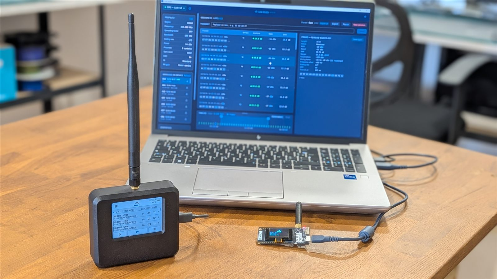
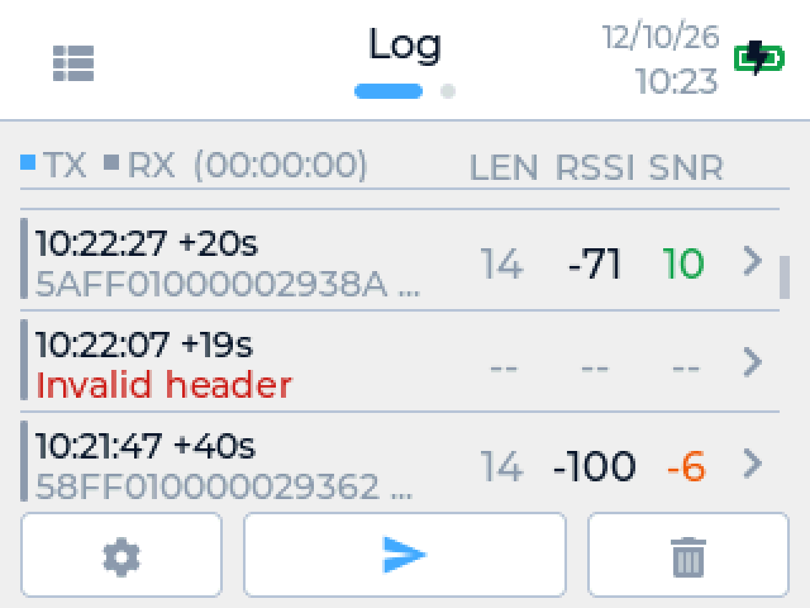
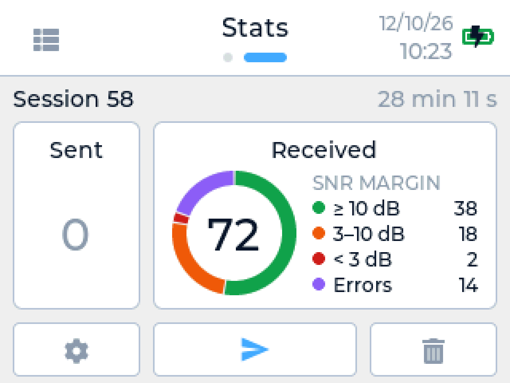
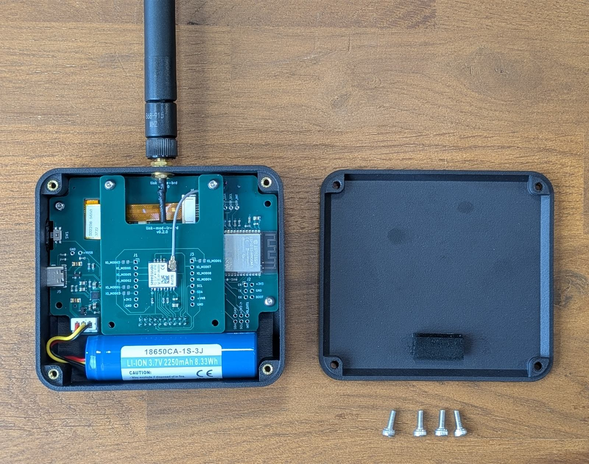

# Link-LR

**A LoRa traffic analyzer and generator** for embedded developers and IoT
integrators. It captures what goes through a LoRa channel and puts frames on
air, to develop, test and validate LoRa equipment and networks (P2P,
Meshtastic, LoRaWAN) at every stage of their life.

It works on its own: touch screen, battery, permanent recording. Plugged into
a laptop, [Link Studio](https://github.com/semtronik/link-studio) reads its
recordings at length, decodes them and keeps them.

## What it does

- **Journal** — every reception as a row: time, interval, length, RSSI, and
  the SNR colored by link margin. Errors are rows too: CRC error, header
  error, incomplete frame.
- **Frame detail** — the measurements taken on each frame, and its bytes.
- **Transmit** — a test frame from the device, with the settings of the
  selected profile; any payload, or any received frame again, from Link
  Studio.
- **Stats** — the current session in figures, frames sorted by margin.
- **Recording** — always on: everything received and sent is kept, and read
  back in Link Studio.

  
  

## Specifications

The base board carries the processor, display, power and battery; the LoRa
module plugs on top of it. Another module makes another product on the same
base.

| | |
|---|---|
| **Radio** | Semtech SX1262 (Seeed Wio-SX1262 module), LoRa |
| **Frequency** | 862 to 930 MHz; EU868 and US915 regions |
| **Settings** | SF 5 to 12; bandwidth 62.5, 125, 250, 500 kHz; coding rate 4/5 to 4/8; sync word, preamble, CRC, IQ, receiver gain |
| **Transmit** | −9 to +22 dBm conducted, payload up to 255 bytes; checked against the EU and US limits of the selected region |
| **Antenna** | SMA connector |
| **Per frame** | RSSI, signal, SNR, link margin, channel noise before the frame, RSSI range during it, frequency offset, time on air, status |
| **Display** | 2.8" capacitive touch screen, 320 × 240 |
| **Recording** | Permanent, 4 MiB rotating (about 11 days at one short frame a minute), in sessions |
| **Clock** | Real-time clock on the main battery: timestamps stay right across power-off |
| **Battery** | 18650 Li-ion, 2250 mAh, replaceable |
| **Charging** | USB-C; the device runs while charging |
| **USB** | Native USB-C, no driver to install |
| **Processor** | ESP32-S3, 16 MB flash, 8 MB PSRAM |
| **Enclosure** | MJF printed, PET front; 100 × 90 × 30 mm without antenna, about 200 g |

The link margin is the SNR above the lowest the spreading factor can
demodulate: 10 dB and more is good, 3 to 10 dB fair, below 3 dB poor.

## Availability

Not on sale yet. Planned price and email sign-up:
[semtronik.com/en/link-lr](https://semtronik.com/en/link-lr).

## Open source

| | Repository | License |
|---|---|---|
| Firmware | [`link-firmware`](https://github.com/semtronik/link-firmware) | GPL-3.0 |
| Hardware | [`link-hardware`](https://github.com/semtronik/link-hardware) | CERN-OHL-S v2 |
| Desktop app | [`link-studio`](https://github.com/semtronik/link-studio) | MIT |
| Protocol and recording format | [`protocol/v1`](../protocol/v1) | MIT |

_LoRa® is a registered trademark of Semtech Corporation._
